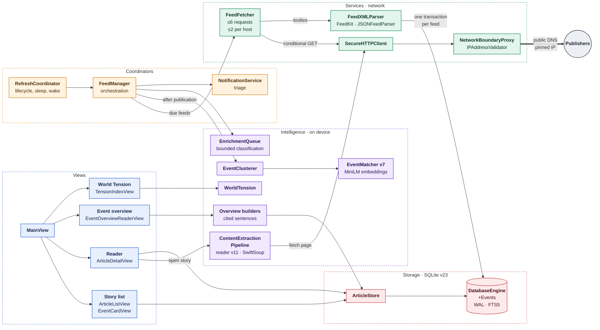
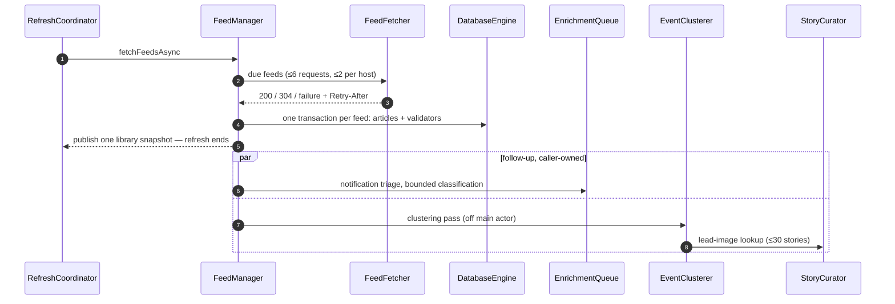
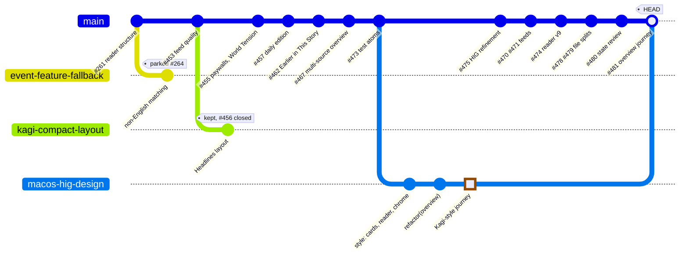
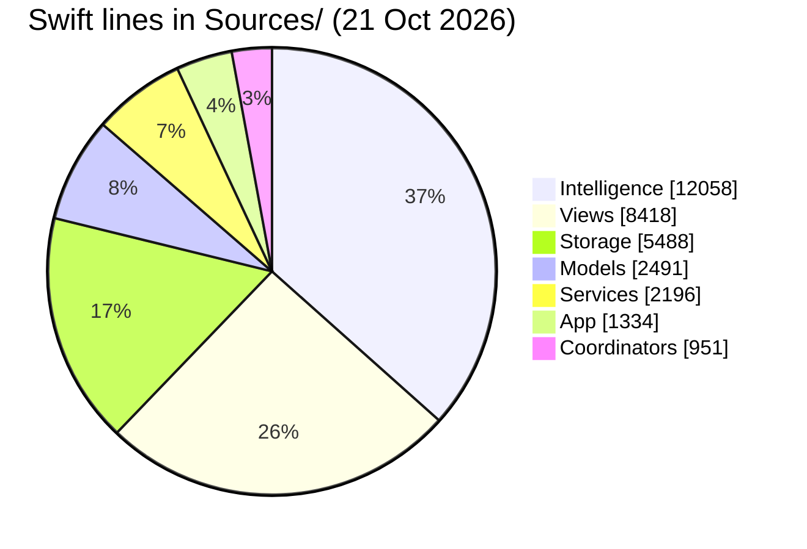
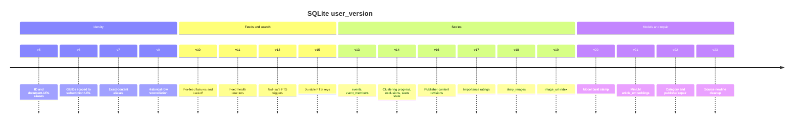

# Architecture

Native macOS, local-first RSS reader. This page is the contract for technology and implementation invariants. Workflow lives in [CONTRIBUTING.md](../CONTRIBUTING.md), design in [DESIGN.md](DESIGN.md), security in [SECURITY.md](../SECURITY.md), privacy in [PRIVACY.md](../PRIVACY.md).

> [!IMPORTANT]
> Nothing leaves the Mac except feed, article and image requests through the protected gateway. No cloud backend, remote AI, custom AI models, telemetry or analytics SDKs.

## Stack

| | |
|---|---|
| Language / UI | Swift 6, SwiftUI, narrow AppKit/WebKit. Minimum macOS 15; gate newer APIs, never raise the minimum casually. |
| Apple frameworks | Foundation, Network, SQLite3 (WAL + FTS5), NaturalLanguage, CoreML, conditional FoundationModels, OSLog/signposts, Swift Concurrency. |
| Packages (SwiftPM, static archive) | **SwiftSoup**: CSS metadata selection and bounded HTML5 repair. **FeedKit**: typed RSS/Atom/JSON models behind the app's own XML safety boundary. New dependencies need a requirement with no reasonable native answer. |
| Builds | arm64, ad-hoc signed, App Sandbox + Hardened Runtime. Intel/universal and notarization are out of current scope. |
| UI rules | Native keyboard/trackpad, accessibility, semantic tokens, restrained Liquid Glass ([DESIGN.md](DESIGN.md)). |

## System map

Five layers, colour-coded. Arrows are calls; the thick arrow to publishers is the only way out of the Mac, through the protected gateway.

## One refresh, end to end

The refresh ends at publication. Everything after it is follow-up work that never holds the refresh, its loading state or the next manual refresh.

## How `main` moves

Every change lands as a focused PR, squash-merged. Open and parked branches stay off `main` until reviewed against current code.

## Where the code is

| Area | Owns |
|---|---|
| `Sources/App/` | `NewsApp` lifecycle, scenes, commands, notification routing · `AppContainer` DI · `AppSettings` defaults, feed URL normalization, mute rules storage · `ThemeManager` · `UpdateChecker` · `NewsSignposts` |
| `Sources/Views/` | `MainView` coordinator · `SidebarView`, `ArticleListView`, `ArticleCardView`, `EventCardView`, `FeedHealthLine` · `ArticleDetailView` + `ReaderSupportViews`, `ArticleWebView`, `WebPreviewPolicy` · `EventOverviewReaderView` · `TensionIndexView` · `ArticleRemoteImage` · `FeedCatalogView` · `SettingsView` · `DesignSystem`, `GlassSystem` |
| `Sources/Storage/` | `DatabaseEngine` schema, WAL/FTS5 · `DatabaseEngine+Events` events, overviews, reading state, embeddings · `ArticleStore` · `MigrationCoordinator` · `ReadManager`, `SavedStoriesManager` · `CacheManager` (HTTP cache, separate from user state) |
| `Sources/Models/` | `FeedArticle`, `ArticleIdentity` · `FeedFetchState` validators and backoff · `FeedCatalog` · `EventOverview`, `EventFeed` · `FeedAdvisory`, `ArchiveSearchToken` · `MuteRules` · `FeedError` |
| `Sources/Coordinators/` | `FeedManager` orchestration · `RefreshCoordinator` lifecycle · `NotificationService` triage |
| `Sources/Services/` | `FeedFetcher`, `SecureHTTPClient` · `FeedXMLParser`, `JSONFeedParser`, `DateParser` · `IPAddressValidator`, `NetworkBoundaryProxy` · `OPMLManager` |
| `Sources/Intelligence/` | `ContentExtractionPipeline` · `ArticleIntelligence` · `EnrichmentQueue` · `EventCandidates` (+ `EventStoryRelation`) · `EventMatcher`, `EventClustering`, `SentenceEmbedder` · `Overview*`, `PassageFactExtractor`, `CoverageSentimentEvaluator` · `StoryImportance`, `EventJudge`, `ModelAvailability`, `PromptDefense` · `WorldTension`, `TensionMethodology` |
| `Tests/` | `NewsTests` runner and suites · `FeedKitSwiftSoupTests`, `EventEmbeddingTests`, `NotificationAttachmentTests`, `StoryCorpus` · `Native*` and accessibility harnesses (some open windows, opt-in) · `TestDefaults` |
| Platform | `News.entitlements` · `build.sh`, `test.sh`, `script/build_test_runner.sh` (runner build, `NEWS_TEST_ATOM`), `script/ci_testsuite.sh` (one JUnit case per `Tests/*.swift` atom, `--lcov` for impact analysis) · dormant `build_release.sh`, `script/distribution/` · CI: `.github/workflows/`, `.circleci/config.yml`, `codemagic.yaml` |

## Schema history

SQLite changes always ship as migrations that preserve WAL/FTS5, saved stories, read history and settings.

## Invariants

Open a section before changing that area. Each rule is load-bearing; tests cover most of them.

<b>Layering, concurrency, lifecycle</b>

- No UI concerns in database, networking or domain layers. No main-actor database work.

- Preserve actor isolation; bound batch concurrency and memory; avoid retain cycles.

- Cancellation propagates through feed, extraction and enrichment. Shared refresh work survives one waiter cancelling; explicit reset cancels it.

- Unstructured tasks need an explicit lifecycle owner.

- Ingestion stays cheap. Extraction and analysis run on demand or under bounded enrichment rules.

<b>Article identity and storage</b>

- Stored article IDs never change when publisher metadata changes. Homepage and missing URLs are never dedup keys.

- Resolution order: scoped GUID (v6) → document-URL alias (v5) → exact-content alias (v7). URL/GUID evidence wins; conflicting aliases stay ambiguous (NULL target) and are never revived or guessed.

- v9 reconciliation needs an exact document URL plus substantial matching publisher body. Originals stay stored; lists/search/counts hide them; old IDs resolve to the survivor with unioned read/save state. `includingOriginals` retrieves them.

- Undated articles keep the `Date.distantPast` sentinel; ordering, paging and retention fall back to ingestion time. Upserts keep known values when incoming metadata is invalid.

- v15 FTS joins and triggers use `article_fts_rows` keys, never the hidden rowid (safe across `VACUUM`). v12 triggers skip identical refreshes.

- v16: publisher input (title, summary, body) is hashed; at most 20 revision rows per article, no body copies. A change invalidates article analysis and affected overviews; every write carries its input hash and is rejected if input moved. The reader labels local observations, never verified corrections.

- Multi-step writes use transactions.

<b>Subscriptions, refresh, networking</b>

- Subscription URLs are stored after `AppSettings.normalizeFeedURL` (lowercase scheme/host, HTTPS, bare root slash removed). A non-root trailing slash is part of the address. Duplicate checks use slash-insensitive `AppSettings.feedKey`. Stored subscriptions are never rewritten: scoped GUIDs hash the exact string.

- `FeedFetcher` is the single refresh path: ≤6 requests, ≤2 per host. Backoff 10 min doubling to 6 h; `Retry-After` on 429/503 is a lower bound capped at 24 h. Local rejections, cancellation and fully offline batches are not failures.

- Requests are conditional. ETag/Last-Modified live in `feeds`, written only inside the ingestion transaction, short printable ASCII only; 304 touches nothing.

- Sleep cancels a refresh without recording failures. After wake (short network delay) one refresh runs if needed.

- Background classification skips Low Power Mode and serious thermal state; scheduled refreshes honor `NSBackgroundActivityScheduler.shouldDefer`.

- New-story notifications use IDs inserted by a committed transaction, skip muted stories, and resolve via SQLite by stable ID once storage is ready.

- All URLs, feed bodies, HTML, redirects and OPML are untrusted. Remote fetching goes through the protected gateway: public-DNS validation, numeric-IP pinning, response bounds, cancellation. URLSession and WebKit previews share it.

- Feed XML: depth 64, 500 items, entity declarations rejected (64 KiB prolog scan + callbacks), FeedKit gets reserialized DTD-free items ≤512 KiB and never fetches URLs. JSON feeds ≤10 MiB, trimmed to 500 items.

- Image requests honor HTTP freshness/no-store after destination validation; decoded images live in a session-only `NSCache`.

<b>Reader extraction</b>

- `HTMLDOMBuilder` scoring with a quality-checked preference for explicit publisher bodies chosen through SwiftSoup. Repaired nodes pass the same rules.

- Reader v11 removes page furniture by structure and wording, never per publisher:
    - `<h1>` is never body text. The `
` right after it, and a Guardian-style standfirst beside the explicit body, become `standfirst` blocks; a paragraph repeating the standfirst is dropped.
    - Phrasing elements (`span`, `a`, `time`, `strong`, …) never form paragraphs of their own, so a `<time>` stamp is judged as metadata.
    - Utility-hidden subtrees (`hidden`, `d-none`) are skipped unless a responsive class such as `md:block` shows them. Class tokens for author bios, follow-author prompts, `more-on`/most-read/top-stories rails, timestamps, recommendations and native ads are skipped; layout modifiers such as `article-with-sidebar` are not tokens and keep the body.
    - Headings that name navigation ("Most Popular", "Recommended Stories", "Related Articles", "Top Stories") are dropped; a trailing one takes the non-prose cards after it. A short author bio ("… is a space reporter at …") as the first or last text block goes.
    - A body under 5,000 characters that ends in its own "Read full article" or "Continue reading" link is `isComplete: false`, so the reader fetches the page instead of showing the feed teaser.
    - Debug a saved page with `NEWS_DEBUG_BLOCKS=1 ./test_runner --debug-extract page.html` from the repository root.

- Reader v10: short `
` sentences ("He was 34.") stay; ` ` and paragraph breaks inside a block are kept as line breaks (source-formatting newlines stay spaces) without dropping inline formatting; nested lists become items one `level` deeper; data tables (≥2 × 2, short plain cells) become `table` blocks, larger than 8 × 40 a notice, layout tables are read as content; editorial asides become `standfirst` or `pullQuote`; social-post blockquotes become `embed` placeholders; ``/`` mark `baselineShift`; plain "(Updated: …)" stamps are dropped. New fields are optional and unknown kinds decode as paragraphs, so stored documents stay readable.

- Reader v9: scripts/styles end at their first closing tag; explicit bodies are judged with children and must hold ≥40% of scored prose; metering wrappers with ≥2 paragraphs stay; `x-cloak` and form controls are hidden. v8 drops timestamp-only blocks; v7 adds `subscriberOnly` (barriers, `isAccessibleForFree: false`, 401/402; 403 shows the same preview), JSON-LD `articleBody` and `__NEXT_DATA__` fallbacks, standfirsts, pull quotes. Older stored documents re-extract on open.

- Document v4 keeps inline runs, image candidates, credit and an explicit selected lead; without a selected lead, `ReaderDocument.selectedImage` falls back to the first usable extracted image. The JSON-LD lead image is read before scripts are stripped; feed parsing accepts image file extensions, `data-src`/`data-original`, and `content:encoded` images without body text. Only a document with publisher text (`ReaderDocument.hasPublisherText`) replaces extraction; feed media never overwrites stored text.

- Extraction records the protected final URL and at most one same-origin canonical URL, only after matching text and title. Canonical declarations alone never merge identities.

- Render sanitized HTML. WebKit previews disable publisher scripts and block local resources. Never log secrets, article contents or full sensitive URLs.

<b>Events and clustering</b>

- An article belongs to at most one event (v13), by surviving stored ID. Events never copy source text. Each member-set change bumps the membership version once.

- Merges forward the absorbed ID one hop; splits give moved members a new ID. Neither touches article rows or read/save state. Events cap at 100 members.

- Candidates (`EventCandidateFinder`): ≤8 terms per article as FTS5 phrases, ≤2× `EventCandidatePolicy.limit` rows, ±48 h window, 72 h active lifetime. Candidates are not matches.

- `EventMatcher` v7: headline + first 600 description characters. A pair needs dates within 36 h, a shared specific anchor (a country alone is not enough) and no conflict in language, period, year, weekday, distinguishing figure or place. Grey-zone pairs use MiniLM cosine (`SentenceEmbedder`, v21 embeddings). Admission: one matching pair, ⅔ compatible members (rounded up), the mean-score threshold.

- Clustering is fully on device; no external LLM. Legacy judge types stay only for audit callers.

- `EventClusterer` runs after publication and at launch, off the main actor, ≤2,000 articles per pass. Version upgrades revalidate active events; the earliest subgroup keeps the ID. One transaction moves members and invalidates overviews; rollback leaves work pending.

- v14 `event_exclusions` ("Not the Same Event") and `event_state` (seen version, only grows). Opening an event never marks articles read.

- Regression comparisons follow the 17 October decision in [the release simplification plan](plans/2026-10-17-release-simplification.md). Earlier measurements stay in dated audits.

<b>Overviews and developing stories</b>

- Overviews are generated on request or for the visible event, on `EnrichmentQueue`, never in the refresh path. Opening an article of an event with ≥2 sources requests one.

- `OverviewGenerationCoordinator` shares a run only for the same membership version, input hash and publisher inputs; changed inputs cancel it; only the latest inputs commit. `cancel(eventID:)` stops it for all callers.

- A reader clears the visible event only if it set it (`clearVisibleEvent(owner:)`); after each storage suspension it rechecks its article and input.

- Production overviews are deterministic publisher sentences with per-source citations (`fallbackExcerpts` provenance). Analysis version 9. Up to four representatives without text are extracted first (≤2 concurrent, 4 s each). Citation rows key on overview ID + citation ID.

- The overview reader shows introduction → Highlights grouped by publisher (`ClusteredHighlightGroup`) → timeline rail → perspective cards → numbered sources; superscript citations open the cited passage. Sentences come from `PassageFactExtractor.segmentedSentences`, which rejoins `NLTokenizer` splits at abbreviations (`St.`, `U.S.`, `Dr.`) and inside open quotes; `OverviewComposer` evidence counting uses it.

- Timelines (`OverviewTimelineBuilder`): a verified quote with exactly one explicit date, shown at its stated precision; relative dates are not resolved; fewer than two dates means no timeline.

- "Earlier in This Story" (`EventStoryRelation`): English, earlier event within 7 days, a shared uncommon typed actor (not in >5% and ≥10 of last week's events), a shared place, two shared topic terms, ⅔ member support. ≤80 FTS rows, ≤40 candidates, ≤3 links. Writes nothing. [Audit](audits/2026-10-20-developing-story-links.md): 1 wrong of 45 after the common-actor rule.

<b>Briefing, feed list, muting, images</b>

- Briefing is a daily edition: ≤10 unread, unmuted reports from a 24 h window, ≤500 candidates, ≤2 per publisher, 1 per event. Frozen in preferences across windows until the edition hour (default 7:00) or New Edition. Order: stored importance, publisher coverage, interests from ≤200 recent read/saved stories, then diversity, recency, stable ID. Selection never calls a model.

- Importance never hides or expires stories; refresh never rates it.

- The feed groups an already filtered page (`EventFeedGrouping`). `FeedUpdateBuffer` holds a shown list; additions and regrouping wait behind an explicit update. Saved Stories and History stay ungrouped and unmuted.

- Muting (`MuteRules`) is the reader's own: hosts (cover subdomains) and whole-word topics on headline + feed summary. Applied in SQLite before `LIMIT` via `news_muted_source` / `news_muted_topic`.

- Lead images (`StoryCurator`, after a clustering pass): ≤30 imageless shown stories, `fetchArticleHead` reads ≤256 KiB. An image declared by two stories is a site default and dropped.

- Panel-only feeds are excluded from normal lists before paging; the tension corpus keeps them.

<b>Intelligence, catalog, World Tension</b>

- `NaturalLanguage` + conditional `FoundationModels`, fixed 12-category taxonomy, plain-text model contracts with strict parsing and extractive fallbacks. v20 stamps the macOS build; a model change invalidates generated summaries, not publisher excerpts.

- Persist only intelligence that product behavior needs; keep model identifiers, analysis versions and deterministic fallbacks.

- `FeedHealth` is operational only (availability, freshness, text quality), never a rating of accuracy or trust (`FeedHealth.disclaimer`).

- The starter catalog is opt-in data: nothing auto-subscribes; entries record `FeedCatalog.verifiedOn`. Only free, open sources that open in the reader; others go to `AppSettings.retiredFeeds`. English only (`FeedCatalog.supportedLanguages`); other-language entries stay parked (#264). Re-verify with `NEWS_LIVE_CATALOG_CHECK=1 ./test.sh` and `./test.sh --catalog-reader-access`.

- World Tension (`WorldTension`, methodology v2) reasons over bounded headlines with lexical grounding. `TensionMethodology` and [the v1 methodology](methodology/tension-index-v1.md) change together; it computes no score until weights are calibrated (#158).

