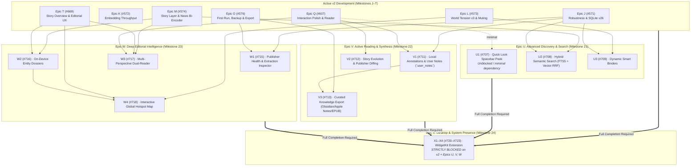

# Next features roadmap (v2+ Horizons) — 28 October 2026

**Status:** Approved by Mars on 28 October 2026; epics U–X (#706, #710, #714, #719) and sub-issues #707–#709, #711–#713, #715–#718, #720–#723 logged on GitHub and Project #2 (Milestones 21–24).  
**Baseline:** `origin/main` (post-Epic R Situation Board Briefing; Epic T in review via PR #705; Milestones J–P active).  
**Decisions taken by Mars on 28 October 2026:**
- Approved core feature set across four post-v2 horizons: Discovery, Active Reading, Editorial Intelligence, and Desktop Presence.
- **Quick Look (U1, #707):** Approved to land early as long as it has zero blocking dependencies from the rest of v2.
- **Widgets (Epic X, #719):** Approved in scope, but strictly blocked on the full completion of v2 (Milestones J–T) and all prior features from this roadmap (Epics U, V, W).
- **Notes Storage (V1, #711):** Named `user_notes` table in SQLite.
- **Logged as Parked Experiments (no active production plans):** Glanceable Menu Bar Popover and Native On-Device Spoken Edition (`AVSpeechSynthesizer`).
- **Invariants preserved:** Local-first, zero cloud AI, zero telemetry, no feed-centric folder tree in sidebar, no unverified generative prose; parked tracks (#264, #268, #651) remain untouched.

---

## 1. Architectural Guardrails & Invariants

All features in this roadmap adhere strictly to [docs/ARCHITECTURE.md](../ARCHITECTURE.md) and [docs/DESIGN.md](../DESIGN.md):
1. **Zero External Network Exfiltration:** No remote LLMs, no analytics SDKs, no cloud sync backends. All network requests flow strictly through the local loopback gateway with DNS verification and pinned public IP literals.
2. **Apple HIG & macOS Citizenship:** Information density, precision pointer ergonomics, keyboard-driven navigation, system accessibility traits, and restrained Liquid Glass for floating controls only.
3. **Verified, Cited Data Only:** Highlights, summaries, and overviews must use cited publisher sentences or verified deterministic extractions. Zero hallucinatory generative prose.
4. **No Feed-Tree Clutter:** The navigation model remains editorial, chronological, and topic-driven. Virtual sections (Smart Binders) operate as dynamic SQLite views, not NetNewsWire-style nested folder hierarchies.

---

## 2. Dependency Graph & Bounding to v2 Development

The roadmap is structured into four distinct program epics (U, V, W, X), with strict dependencies explicitly mapped to the respective v2 implementation deliverables.

---

## 3. Epics and Sub-Issues

### Epic U · Advanced Discovery and Search (Epic #706, Milestone 21)
Focuses on effortless navigation and instant semantic retrieval across the entire local library.

| # | Issue | Scope | Acceptance | Effort | Pri | Dependencies |
|---|---|---|---|---|---|---|
| U1 (#707) | macOS Quick Look (Spacebar Peek) in Story Lists | Pressing Space on any selected story card in list or grid opens native Quick Look preview panel with reader text and images; j/k or arrows cycle preview without losing list position. | Opens on Space; cycles with j/k; Enter opens in reader; Esc/Space dismisses; zero impact on scroll state. | S | P1 | Unblocked; minimal dependency on list keyboard focus |
| U2 (#708) | Hybrid Semantic & Natural Language Search | Combine SQLite FTS5 BM25 with MiniLM / News bi-encoder embeddings via Reciprocal Rank Fusion (RRF); natural language search queries in toolbar. | Top-10 queries match semantic meaning without exact keywords; latency ≤ 25ms on 5,000-story library. | M | P1 | Blocked by M18 (#628), K1 (#540), and J3 (#536) |
| U3 (#709) | Dynamic Smart Binders (Compound Topic Rules) | User-created virtual sections in sidebar evaluated dynamically by SQLite query (category, keywords, exclusion rules). | Binder updates dynamically as stories arrive; zero feed folder hierarchy added; test with compound filter rules. | M | P2 | Blocked by L3 (#546), L11 (#590), and J3 (#536) |

---

### Epic V · Active Reading and Knowledge Synthesis (Epic #710, Milestone 22)
Empowers readers to capture private insights, track evolving news revisions, and export clean research artifacts.

| # | Issue | Scope | Acceptance | Effort | Pri | Dependencies |
|---|---|---|---|---|---|---|
| V1 (#711) | Local Private Annotations and User Notes | Reader text selection popover to highlight (⌘Y) with semantic tint and attach private notes; persisted in `user_notes` SQLite table; collapsible annotations inspector (⌥⌘I); Library "Notes & Highlights" view. | Highlight persists across re-extracts; notes searchable in FTS5; inspector toggles cleanly; DESIGN.md compliance. | M | P1 | Blocked by J3 (schema migration v27) and Q2 (#594) |
| V2 (#712) | Story Evolution and Live Publisher Diffing | Visual diff view in reader for articles with multiple `PublisherContentRevision` records; highlights additions in soft tint and shows retractions. | Header update pill shows revision count; diff highlights changes clearly without layout jumps; verified on multi-revision fixtures. | M | P2 | Blocked by Q2/Q5 and Reader v11 pipeline |
| V3 (#713) | Curated Knowledge Export (Obsidian, Apple Notes, Markdown, EPUB) | Frontmatter Markdown export for Obsidian/Bear, "Add to Apple Notes" via native sharing, daily Briefing digest generator, and offline .epub compilation. | Export valid UTF-8 Markdown with YAML frontmatter, cited quotes, and user notes; EPUB opens cleanly in Apple Books. | M | P2 | Blocked by O4 (#565) and V1 |

---

### Epic W · Deep Editorial Intelligence and Perspectives (Epic #714, Milestone 23)
Surfaces feed health transparency, entity relationship networks, multi-perspective contrasts, and global situation geography.

| # | Issue | Scope | Acceptance | Effort | Pri | Dependencies |
|---|---|---|---|---|---|---|
| W1 (#715) | Publisher Health and Extraction Quality Inspector | Native health dashboard in Settings › Subscriptions showing HTTP reliability %, full-text extraction vs. paywall/teaser rate %, publishing latency, and paywall classification. | Table renders fetch status, extraction success %, and actionable diagnostics; zero main-thread stall on 100+ feeds. | S | P1 | Blocked by J3 and O3 (#564) |
| W2 (#716) | On-Device Entity Dossiers and Context Cards | Entity profile card/popover for persons, organizations, and places extracted by NLTagger; 30-day coverage timeline, related entities, and source breakdown across local SQLite. | Popover opens from recognized entities in overview and reader; 0 network calls; query returns in < 15ms. | L | P2 | Blocked by M8 (#581) and T4 (#673) |
| W3 (#717) | Multi-Perspective Dual-Reader (Side-by-Side Coverage Comparison) | Side-by-side reading of two distinct publisher reports on the same event for wide displays (>1200 pt), with synchronized passage scrolling and highlighted perspective contrast. | Split view renders on wide displays; synchronized scrolling on shared citations; degrades gracefully on narrow windows. | M | P2 | Blocked by M8 (#581), T4 (#673), and Q2 |
| W4 (#718) | Interactive Global Hotspot Map (World Tension / International Desk) | Offline vector map in World Tension sheet or dedicated Global Desk; maps event clusters to regions using offline location extraction and country centroids; visualizes global coverage volume and tension factors. | Fully offline vector map rendering; clickable region filters panel headlines; zero external telemetry. | L | P2 | Blocked by L9 (#585), T2 (#671), and W2 |

---

### Epic X · Desktop and System Presence (WidgetKit) (Epic #719, Milestone 24, PARKED)
Extends News onto the macOS Sequoia/Sonoma/Tahoe desktop and Notification Center.

> [!IMPORTANT]
> **Blocked on Roadmap:** Epic X is strictly blocked on the full completion of v2 (Milestones J–T) AND all prior approved features in this roadmap (Epics U, V, and W). No implementation PRs are to be scheduled until all prerequisite epics are closed.

| # | Issue | Scope | Acceptance | Effort | Pri | Dependencies |
|---|---|---|---|---|---|---|
| X1 (#720) | Shared Database Snapshot & App Group Container for Widgets | Read-only SQLite snapshot export or App Group container setup with strict sandbox entitlements, allowing widget process to read data safely. | Widget extension reads headlines, lead images, and tension score without database lock contention or sandbox errors. | M | P2 | Blocked on v2 + Epics U, V, W |
| X2 (#721) | Situation Board Hero Desktop Widget (Medium & Large) | WidgetKit view displaying today's #1 Briefing story card with cover photo, key takeaway snippet, and publisher count. | Deep-links via `news://story/<id>`; updates on publication; renders cleanly in light/dark on macOS desktop. | M | P2 | Blocked on X1 |
| X3 (#722) | World Tension Gauge Widget (Small & Medium) | Compact system gauge displaying the current World Tension score (0–100°), 7-day sparkline trend, and top driving crisis headline. | Renders tension score, band color, sparkline, and lead headline; pauses animation when not active. | S | P2 | Blocked on X1 |
| X4 (#723) | Breaking and Top Stories List Widget (Medium & Large) | Dense headline list widget for Notification Center or desktop displaying top 3–5 breaking stories with unread indicators and deep links. | Displays top 3–5 stories; unread dots match app state; deep-links to individual stories. | S | P2 | Blocked on X1 |

---

## 4. Parked Ideas & Explorations (No Active Plans for Production)

The following items were brainstormed and reviewed by Mars on 28 October 2026, with the decision to keep them purely as recorded ideas/experiments without scheduling implementation PRs:

1. **Glanceable Menu Bar Popover (Companion Mode):** An interactive 320 pt popover opening from the menu bar icon showing Briefing's top 3 headlines and World Tension. (Parked; Issue #561 `MenuBarExtra` menu remains the shipping implementation).
2. **Native On-Device Spoken Edition (`AVSpeechSynthesizer`):** Offline speech synthesis with Apple Neural Voices for hands-free listening to Briefing and articles. (Parked; out of immediate scope).

---

## 5. Execution Phasing and Ordering

1. **Horizon 1A (Unblocked Quick Win):**
   - **U1 (#707, Quick Look Spacebar Peek):** Self-contained, keyboard-driven triage tool in `ArticleListView`.
2. **Horizon 1B (Data Transparency & Health):**
   - **W1 (#715, Publisher Health Inspector):** Diagnostic transparency in Settings › Subscriptions as v2 storage and first-run milestones stabilize.
3. **Horizon 2 (Discovery & Active Reading - Post v2 Foundations):**
   - **U2 (#708, Hybrid Semantic Search):** Lands after M18 News bi-encoder and K1 throughput pass.
   - **V1 (#711, Local Annotations & `user_notes`):** Lands with SQLite v27 schema migration.
   - **U3 (#709, Smart Binders):** Dynamic topic streams in sidebar.
   - **V2 (#712, Story Evolution):** Visual diffing of publisher revisions.
   - **V3 (#713, Curated Knowledge Export):** Markdown frontmatter and EPUB compilation.
4. **Horizon 3 (Advanced Perspectives & Spatial Intelligence):**
   - **W2 (#716, Entity Dossiers):** Deep co-occurrence graph across local archive.
   - **W3 (#717, Multi-Perspective Dual-Reader):** Side-by-side comparative reader on wide screens.
   - **W4 (#718, Global Hotspot Map):** Offline vector geopolitical projection.
5. **Horizon 4 (Desktop Presence - Final Gate):**
   - **X1–X4 (#720–#723, WidgetKit Desktop & Notification Center):** Implemented only after v2 and Epics U, V, and W are completely finished.
